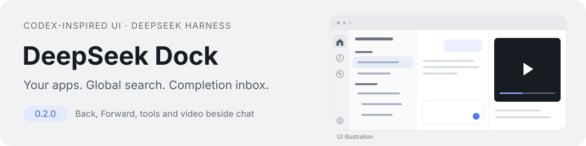
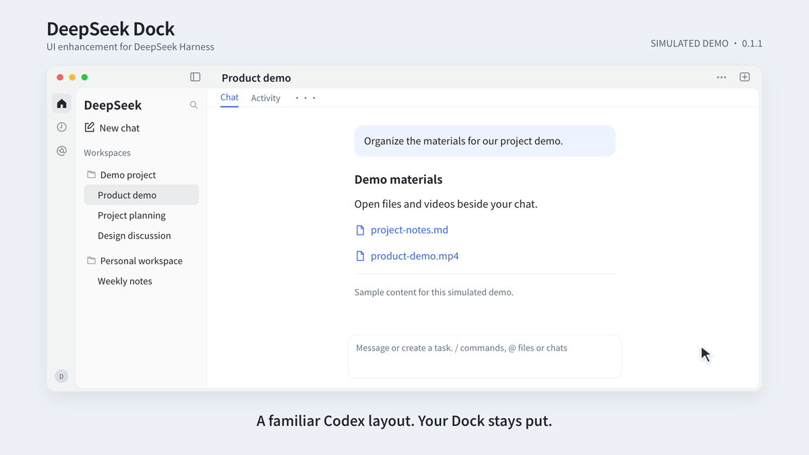
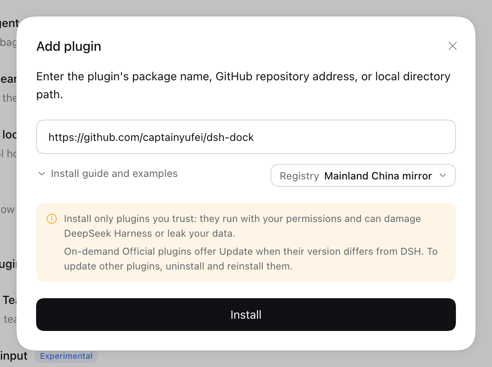

# DeepSeek Dock

**English** · [Simplified Chinese](README.zh-CN.md)

**A persistent, customizable left Dock and a Codex-inspired UI for DeepSeek Harness.**



Pin important chats across workspaces, draft on Home without creating a chat until you send, and preview videos in the right file panel beside the conversation. DeepSeek Dock installs independently without modifying the host application, preserving DeepSeek branding and native tools.

`0.1.1` · Target environment: **macOS / Harness 0.2.1-rc.5** · Third-party community plugin

[Install](#install) · [Features](#features) · [Compatibility and limits](#compatibility-and-limits) · [Migration](docs/MIGRATION.md) · [Report an issue](https://github.com/captainyufei/dsh-dock/issues)

## See it in action

[](assets/readme/demo.en.mp4)

**[Watch the full 45-second demo with music](assets/readme/demo.en.mp4)** · [Watch in Chinese](assets/readme/demo.mp4) · [Static preview](assets/readme/poster.en.png)

The 45-second silent loop walks through all five features below. Click it for the version with music. Both formats use simulated UI and sample data; they are not screen recordings or performance tests.

## Features

| Feature | What changes in everyday use |
|---|---|
| **Persistent, customizable Dock** | Switch between Home, scheduled tasks, and plugins even with the chat list collapsed. Choose the entries you use and drag them into your preferred order. |
| **Codex-inspired UI** | Home, chats, plugins, and scheduled tasks share one window frame and draggable top strip. Moving between pages keeps the same navigation and tool controls, with DeepSeek branding and the native chat hierarchy. |
| **Cross-workspace pins** | Find important chats from different workspaces in one pinned section. Each appears only once; unpinning returns it to its original group without changing workspace membership. |
| **Draft-first Home** | Compose and revise before committing to a chat. A chat is created only when you send, so unsent ideas do not fill the sidebar with empty entries. |
| **Video in the file panel** | Play and seek a generated video on the right while checking the conversation beside it. Reopening the tool drawer restores existing tabs so you can continue reviewing the same content. |

## Install

Requires **macOS / Harness 0.2.1-rc.5**. Disable the old `@local/chatgpt-rail` plugin first if installed ([migration](docs/MIGRATION.md)). This package is not published to npm; use the repository URL below. No manual build is needed.

This installs the latest code on `main`, not the latest stable release. Installed copies do not update automatically.

### Install in DeepSeek Harness

Open **Plugins → Add plugin**, paste this into **Package name or address**, and click **Install**:

```text
https://github.com/captainyufei/dsh-dock
```

When **Installed** appears, click **Enable now**. Closing the dialog instead leaves the plugin switched off.



Confirm **DeepSeek Dock** is on under **Installed plugins**. Collapse the chat list: Home, scheduled tasks, and plugins should remain in the left Dock. Right-click the Dock to customize its entries.

### Install with the `dsh` CLI

For the **web profile**, run:

```sh
dsh plugin --profile web add https://github.com/captainyufei/dsh-dock
```

Start `dsh web` if it is not already running, then open **Plugins** and make sure DeepSeek Dock is enabled. The command targets the web profile; desktop users should use the installation dialog above.

### Update or remove

To get the current `main` code, save your work, open **Plugins → DeepSeek Dock → Uninstall**, and confirm. Reinstall using the same repository URL or CLI command above, then enable it. Follow any reload/restart notice and check the source and version in the plugin details. Reinstallation is required; reopening Harness does not fetch new code.

To disable Dock temporarily, turn off its switch. Uninstall without reinstalling to remove it. Both actions preserve host-managed chats and workspaces.

<details>
<summary>Alternative: install from a local ZIP</summary>

1. [Download the current main branch](https://github.com/captainyufei/dsh-dock/archive/refs/heads/main.zip) and extract it into a directory you will keep. This is a snapshot of `main` at download time, not a fixed release.
2. Find the root containing `package.json` and `cordis.patch.yml`; keep the complete extracted directory and all its subfolders.
3. Select that folder in Finder and press **Option–Command–C** to copy its absolute path. Paste it into **Plugins → Add plugin**. For example, an account named `alex` might use:

   ```text
   /Users/alex/Plugins/dsh-dock
   ```

   Use your actual folder path, not the example or the ZIP file.
4. Click **Install → Enable now**, and check the Dock as described above. Keep the local directory after installation.

</details>

<details>
<summary>Troubleshooting installation</summary>

| Problem | Next step |
|---|---|
| Package not found | Use the complete repository URL above. This package is not published to npm; its package name or `@latest` is not an installation source. |
| GitHub download fails | Open **Show install details**, check GitHub connectivity, and retry. Changing the npm registry does not fix GitHub access. Use the ZIP option if you can download it separately. |
| Installed, but no Dock | Enable it under **Installed plugins** and follow any restart notice. If activation fails, copy the diagnostic. |
| Wrong host or invalid directory | Use Harness `0.2.1-rc.5`. For local installation, select the root containing `package.json` and `cordis.patch.yml`, with the full extracted contents intact. |

[Report an issue](https://github.com/captainyufei/dsh-dock/issues) with your Harness/macOS versions, source entered, and installation error. Remove private paths or tokens from logs before posting.

</details>

## Everyday controls

Right-click the Dock to select registered entries, then drag icons to reorder them. Home stays first; up to six entries appear directly, with the rest under **More**. Preferences stay local. Right-click a chat for the host's pin, rename, fork, archive/unarchive, and copy Session ID actions; `Shift+F10` and the menu key work too.

Files, terminal, browser, tool tabs, and scheduled tasks are Harness capabilities. DeepSeek Dock adds their surrounding UI and video previews; it does not add a task execution engine.

### Drafts and input

Select a workspace, mode, model, and permissions before composing. Draft text and options survive page navigation and refresh; attachments must be reselected after refresh.

`Enter` sends and `Shift+Enter` inserts a newline. Confirming an IME composition does not send. Use `+` for local files, `@` for file paths or loaded chats, and the microphone for the host voice component. Attachments are handed to the host only on send. Failed sends retain the draft; uncertain results are not automatically retried.

### Restore tools and play videos

Native file tabs preview MP4, M4V, MOV, and WebM with pause, seeking, volume, and fullscreen controls, subject to the codec limits below.

The top-right button restores existing tool tabs. If the active chat has no tabs, it opens the native tool area. The new-tool or chat-selection entry appears only when there is neither an active chat nor restorable content.

Collapsing the drawer, switching tabs, or closing the preview pauses playback and releases temporary media. Reopening within the same tab lifecycle and unchanged file version can restore the position **without autoplay**. Native keyboard controls and focus indicators remain available; window transitions respect reduced-motion preferences.

## Compatibility and limits

| Area | Current scope |
|---|---|
| **Host and platform** | The feature baseline was tested on-device on macOS / Harness `0.2.1-rc.5`. This package restricts installation to that host version. Other operating systems, dark mode, and very narrow windows have not been fully tested on-device. |
| **Video codecs** | Recognizing an extension does not guarantee that every codec decodes. Support depends on the system/browser; H.264/AAC MP4 has been tested. Unsupported files can open in a system application. |
| **Desktop video size** | Desktop reads a complete temporary Blob before playback. Cached and in-flight media bytes share a **256 MiB** budget, with external opening available above it. This is not a process peak-memory cap. |
| **Playback position** | Restoration is limited to the same tool tab lifecycle and file version, not guaranteed after an app restart. |
| **Drafts and voice** | Attachments do not survive refresh. Voice requires the host component and local recognition resources. `/` commands and `@` suggestions depend on host catalogs and permissions. |
| **Language** | The README is bilingual. Some added interface copy is still Chinese; full UI localization is not complete. |

Version `0.1.1` remains an early `0.x` release; removing the beta suffix does not expand the tested platform or host scope.

Hiding pinned chats can reduce the visible row count on a native group's first page. Expand the group to see more. The plugin uses host slots, services, and some DOM structure; host upgrades require renewed validation and are not automatically compatible.

## Development and contributions

Run from the source repository root:

```sh
npm ci
npm test
npm run build:client
```

`npm test` builds before running tests; the runtime shares the host's React. Rebuild `dist/client.js` after editing source, then load the update through the host. Test results should come from the current commit's actual run; the simulated demo does not replace functional acceptance.

[Architecture and state ownership](docs/ARCHITECTURE.md) · [Contributing](CONTRIBUTING.md) · [Versioning and releases](docs/RELEASING.md) · [Changelog](CHANGELOG.md)

## License and provenance

DeepSeek Dock is an independently developed third-party plugin and is not affiliated with DeepSeek or OpenAI. "Codex-inspired" describes the layout, not an affiliation. The project is licensed under the [MIT License](LICENSE). See [THIRD_PARTY_NOTICES](THIRD_PARTY_NOTICES.md) for referenced code and third-party licenses.
