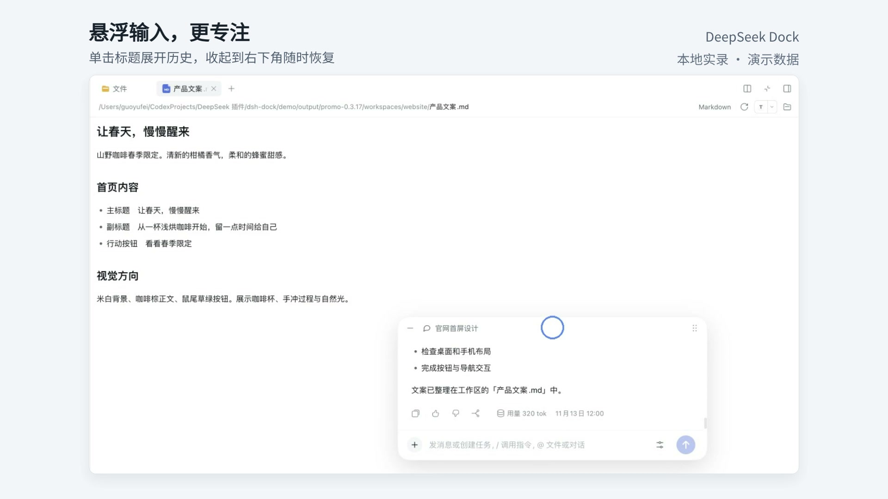
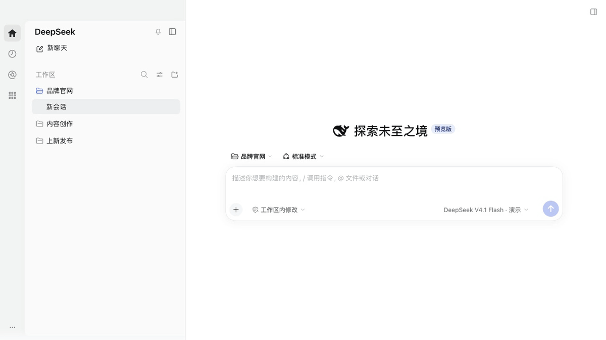
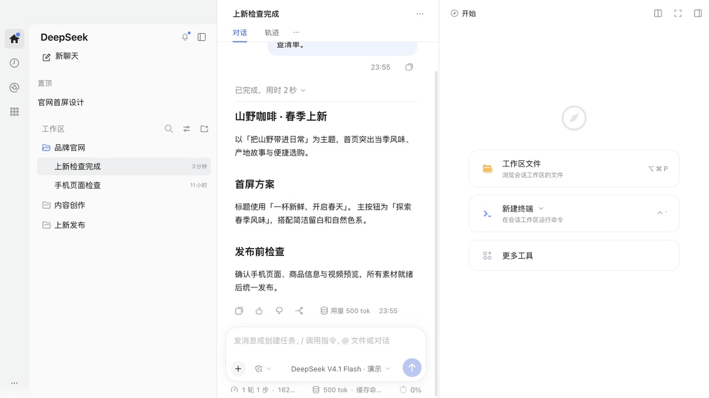
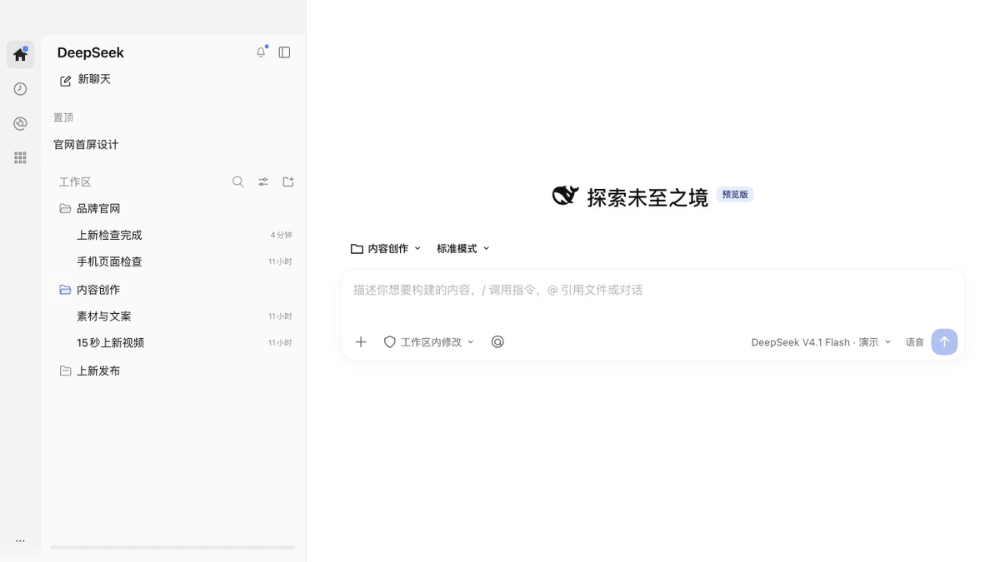
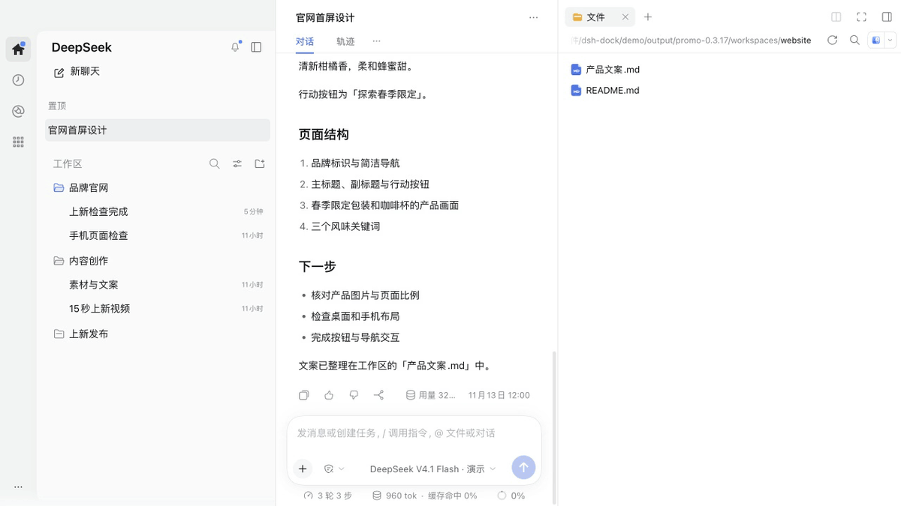
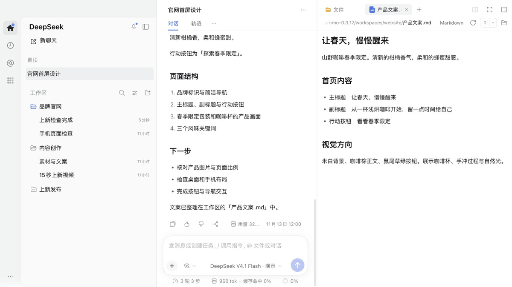
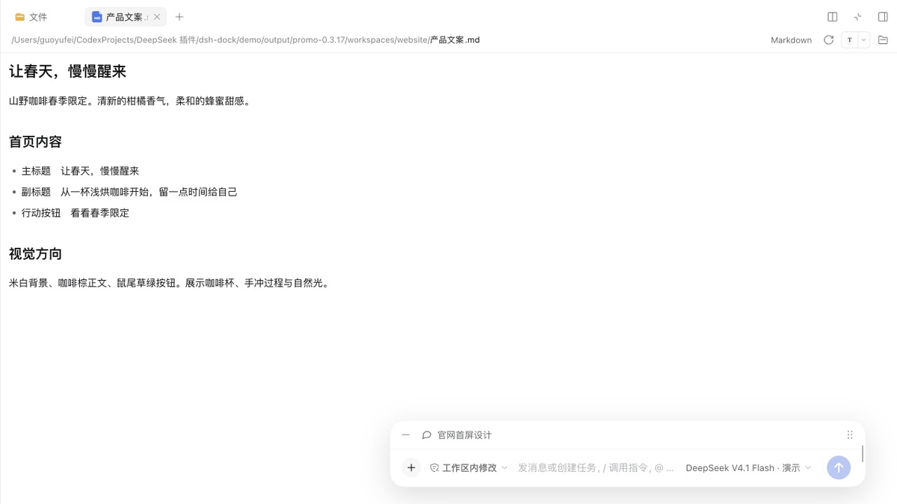

# DeepSeek Dock

**English** · [Simplified Chinese](README.zh-CN.md)

**A persistent, customizable left Dock and a Codex-inspired UI for DeepSeek Harness.**



Pin important chats across workspaces, draft on Home without creating a chat until you send, and preview videos in the right file panel beside the conversation. DeepSeek Dock installs independently without modifying the host application, preserving DeepSeek branding and native tools.

`0.3.17` · Validated hosts include **macOS / Harness 0.2.1-rc.5, 0.2.2-rc.1 and 0.2.2-rc.2** · Third-party community plugin

[Install](#install) · [Features](#features) · [Compatibility and limits](#compatibility-and-limits) · [Migration](docs/MIGRATION.md) · [Report an issue](https://github.com/captainyufei/dsh-dock/issues)

## See it in action

**[Watch the 66-second demo with music](assets/readme/promo-0.3.17/deepseek-dock-0.3.17.mp4)** · [Download the media bundle](https://github.com/captainyufei/dsh-dock/releases/download/v0.3.17/DeepSeek-Dock-0.3.17-media.zip)

Each GIF shows one feature in 10 seconds. The new film has Chinese feature captions. It records the local 0.3.17 UI with fictional demo data, using 1280×720 source footage and a 1920×1080 video output. Music reuses the existing project soundtrack.

| Dock and pinned apps | Global search and notifications |
|---|---|
|  |  |
| **Cross-workspace pins and drafts** | **Left and right panes** |
|  |  |
| **Floating conversation** | **Resize, snap and compact settings** |
|  |  |

The [earlier English demonstration](assets/readme/demo.en.mp4) covers the 0.2.0 feature set.

## Features

| Feature | What changes in everyday use |
|---|---|
| **Application Dock and overview** | Open registered plugin pages through monochrome icons, pin and reorder them, or find them in All Apps. Recent unpinned apps have their own section. |
| **Global search** | Find chat titles, workspaces and quick actions in one palette; chat-body search is available when the Host index is enabled. |
| **Session inbox** | Review completion excerpts and pending interactions. Home and the bell share an unread dot, and read completion records remain available. |
| **Back and Forward** | Revisit global pages and existing chats visited in the current window. |
| **Codex-inspired UI** | Home, chats, plugins, and scheduled tasks share one window frame and draggable top strip. Moving between pages keeps the same navigation and tool controls, with DeepSeek branding and the native chat hierarchy. |
| **Cross-workspace pins** | Find important chats from different workspaces in one pinned section. Each appears only once; unpinning returns it to its original group without changing workspace membership. |
| **Draft-first Home** | Compose and revise before committing to a chat. A chat is created only when you send, so unsent ideas do not fill the sidebar with empty entries. |
| **Video in the file panel** | Play and seek a generated video on the right while checking the conversation beside it. Reopening the tool drawer restores existing tabs so you can continue reviewing the same content. |

### Conversation layout

When the content panel is open, choose **Move to right panel** from the Conversation header’s native **More** menu. After the exchange, that menu offers **Move to left panel**. Fullscreen content keeps the native composer available as a compact input bar. Activating it reveals the title bar, and clicking the title expands or folds message history. Drag any edge to adjust its width or height. Dragging the title bar and releasing it snaps the card to one of four corners or the bottom center according to its position. At widths of 640px or below, a single settings icon opens model, reasoning and access permission controls. The title bar and resize edges support arrow keys, with Shift for larger steps. Minimize the card into a bottom-right chat button and click it to restore the saved dimensions. Its own More menu returns Chat to either pane or the Conversation full view. Motion follows the system's reduced-motion preference. Floating conversation usage counters are hidden by default; use **More → Show conversation usage** to display them. This choice is saved locally and synchronized across windows.

The split retains the Session's native browser, file, terminal and video tabs. Narrow windows close the fullscreen overlay when returning to Chat. Layout choices and positions are held per Session in the current window. New layout acceptance targets Harness `0.2.2-rc.2`.

## Install

Requires **macOS / Harness 0.2.1-rc.5 or the 0.2.2 line from rc.1**. Disable the old `@local/chatgpt-rail` plugin first if installed ([migration](docs/MIGRATION.md)). Install the prebuilt runtime from the repository URL below. Versioned TGZ and ZIP packages are also available from [GitHub Releases](https://github.com/captainyufei/dsh-dock/releases/latest); extract the ZIP and select the complete folder containing `package.json`.

The repository URL follows the latest code on `main`. Use a versioned release asset for a fixed build. Check the installation source when upgrading an existing copy.

### Install in DeepSeek Harness

Open **Plugins → Add plugin**, paste this into **Package name or address**, and click **Install**:

```text
https://github.com/captainyufei/dsh-dock
```

When **Installed** appears, click **Enable now**. Closing the dialog instead leaves the plugin switched off.


Confirm **DeepSeek Dock** is on under **Installed plugins**. Collapse the chat list: Home, scheduled tasks, and plugins should remain in the left Dock. Right-click the Dock to customize its entries.

### Install with the `dsh` CLI

For the **web profile**, run:

```sh
dsh plugin --profile web add https://github.com/captainyufei/dsh-dock
```

Start `dsh web` if it is not already running, then open **Plugins** and make sure DeepSeek Dock is enabled. The command targets the web profile; desktop users should use the installation dialog above.

### Update or remove

Save your work first. If your plugin manager offers **Update** for DeepSeek Dock, use it, then follow any reload/restart notice. For a TGZ, directory or repository installation, install the new release through **Add plugin** or the official CLI using the same package name. Confirm version **0.3.17** in the plugin details. Reopening Harness alone does not fetch new code.

To disable Dock temporarily, turn off its switch. Uninstall without reinstalling to remove it. Both actions preserve host-managed chats and workspaces.

<details>
<summary>Alternative: install from a local ZIP</summary>

1. [Download the current main branch](https://github.com/captainyufei/dsh-dock/archive/refs/heads/main.zip) and extract it into a directory you will keep. This is a snapshot of `main` at download time, not a fixed release.
2. Find the root containing `package.json` and `cordis.patch.yml`; keep the complete extracted directory and all its subfolders.
3. Select that folder in Finder and press **Option–Command–C** to copy its absolute path. Paste it into **Plugins → Add plugin**. For example, an account named `alex` might use:

   ```text
   /Users/alex/Plugins/dsh-dock
   ```

   Use your actual folder path, not the example or the ZIP file.
4. Click **Install → Enable now**, and check the Dock as described above. Keep the local directory after installation.

</details>

<details>
<summary>Troubleshooting installation</summary>

| Problem | Next step |
|---|---|
| Package not found | Use the complete repository URL above or a TGZ from the release page. Check the package name and installation source in the error details. |
| GitHub download fails | Open **Show install details**, check GitHub connectivity, and retry. Changing the npm registry does not fix GitHub access. Use the ZIP option if you can download it separately. |
| Installed, but no Dock | Enable it under **Installed plugins** and follow any restart notice. If activation fails, copy the diagnostic. |
| Wrong host or invalid directory | Update Dock to `0.2.2` or newer for Harness `0.2.2-rc.2`. The admission range also covers `0.2.1-rc.5` and the `0.2.2` line from `rc.1`, before `0.2.3`. An older installed Dock copy retains its old version restriction. For local installation, select the root containing `package.json` and `cordis.patch.yml`, with the full extracted contents intact. |

[Report an issue](https://github.com/captainyufei/dsh-dock/issues) with your Harness/macOS versions, source entered, and installation error. Remove private paths or tokens from logs before posting.

</details>

## Everyday controls

Open **All Apps** at the bottom of the Dock to search and filter all, pinned or recent entries. Right-click an icon to pin/remove or move it. Drag pinned icons to reorder them; releasing in an icon gap works, and Escape cancels. Home stays first. Pinned icons scroll when needed; recent unpinned apps follow a divider. Preferences remain local.

Use the sidebar search button or the Host search-chats shortcut for global search. Arrow keys select, Enter opens, and Escape closes. Title/workspace search remains available when the Host body-search index is disabled, with an explanatory notice.

The bell opens completion history and pending interactions. New results and pending items light the Home/bell dot. Selecting a completion opens its chat and acknowledges only that result; opening the list does not acknowledge it. History before first activation normally appears as read. Some legacy logs may remain unreadable.

The leading Back/Forward buttons track global pages and existing chats visited in the current window; reload resets that history. Chat context menus retain native pin, rename, fork, archive/unarchive and copy Session ID actions, including `Shift+F10` and the menu key. Pinned rows reuse the Host archive action.

Files, terminal, browser, tool tabs, and scheduled tasks are Harness capabilities. DeepSeek Dock adds their surrounding UI and video previews; it does not add a task execution engine.

### Drafts and input

Select a workspace, mode, model, and permissions before composing. Draft text and options survive page navigation and refresh; attachments must be reselected after refresh.

`Enter` sends and `Shift+Enter` inserts a newline. Confirming an IME composition does not send. Use `+` for local files, `@` for file paths or loaded chats, and the microphone for the host voice component. Attachments are handed to the host only on send. Failed sends retain the draft; uncertain results are not automatically retried.

### Restore tools and play videos

Native file tabs preview MP4, M4V, MOV, and WebM with pause, seeking, volume, and fullscreen controls, subject to the codec limits below.

The top-right button restores existing tool tabs. If the active chat has no tabs, it opens the native tool area. The new-tool or chat-selection entry appears only when there is neither an active chat nor restorable content.

Collapsing the drawer, switching tabs, or closing the preview pauses playback and releases temporary media. Reopening within the same tab lifecycle and unchanged file version can restore the position **without autoplay**. Native keyboard controls and focus indicators remain available; window transitions respect reduced-motion preferences.

## Compatibility and limits

| Area | Current scope |
|---|---|
| **Host and platform** | Validated macOS baselines include `0.2.1-rc.5`, `0.2.2-rc.1` and `0.2.2-rc.2`. The `rc.2` upgrade check covers loading, sidebar structure, expanded/collapsed navigation, 1440/800/480 px browser widths, draft persistence, app/global search, pointer sorting, menus and notifications. Earlier feature and theme evidence remains attached to its original Host version. Other operating systems require their own acceptance. |
| **Video codecs** | Recognizing an extension does not guarantee that every codec decodes. Support depends on the system/browser; H.264/AAC MP4 has been tested. Unsupported files can open in a system application. |
| **Desktop video size** | Desktop reads a complete temporary Blob before playback. Cached and in-flight media bytes share a **256 MiB** budget, with external opening available above it. This is not a process peak-memory cap. |
| **Playback position** | Restoration is limited to the same tool tab lifecycle and file version, not guaranteed after an app restart. |
| **Drafts and voice** | Attachments do not survive refresh. Voice requires the host component and local recognition resources. `/` commands and `@` suggestions depend on host catalogs and permissions. |
| **Language** | The README is bilingual. Some added interface copy is still Chinese; full UI localization is not complete. |

Version `0.3.17` admits `0.2.1-rc.5 || >=0.2.2-rc.1 <0.2.3-0`. Later admitted candidates are checked as they appear. The maintenance workflow and update-source requirements are documented in [Compatibility and update delivery](docs/COMPATIBILITY.md).

Hiding pinned chats can reduce the visible row count on a native group's first page. Expand the group to see more. The plugin uses host slots, services, and some DOM structure; host upgrades require renewed validation and are not automatically compatible.

## Development and contributions

Run from the source repository root:

```sh
npm ci
npm test
npm run build:client
```

`npm test` builds before running tests; the runtime shares the host's React. Rebuild `dist/client.js` after editing source, then load the update through the host. Test results should come from the current commit's actual run; the simulated demo does not replace functional acceptance.

[Architecture and state ownership](docs/ARCHITECTURE.md) · [Shared window surface](docs/SURFACES.md) · [Contributing](CONTRIBUTING.md) · [Versioning and releases](docs/RELEASING.md) · [Changelog](CHANGELOG.md)

## License and provenance

DeepSeek Dock is an independently developed third-party plugin and is not affiliated with DeepSeek or OpenAI. "Codex-inspired" describes the layout, not an affiliation. The project is licensed under the [MIT License](LICENSE). See [THIRD_PARTY_NOTICES](THIRD_PARTY_NOTICES.md) for referenced code and third-party licenses.
