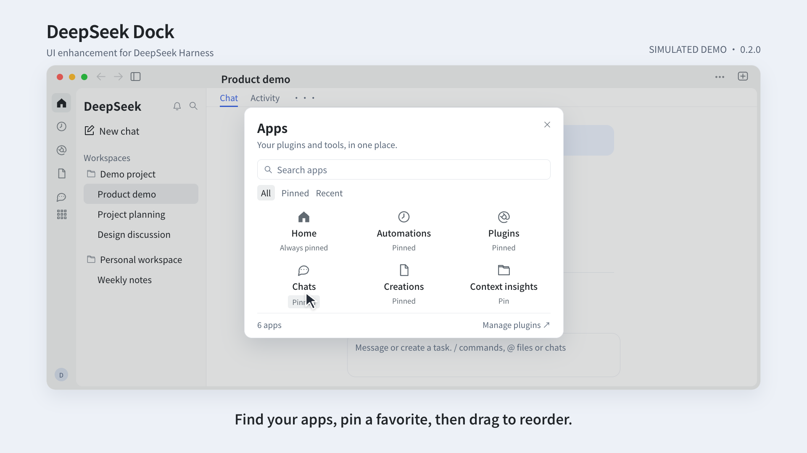

# DeepSeek Dock

**English** · [简体中文](README.zh-CN.md)

**Collapse the chat list. Still reach Home, tasks, and plugins in one click.**


DeepSeek Dock is a UI extension for DeepSeek Harness. It keeps navigation on the left, collects important chats in one pinned section, and opens files and videos beside the conversation. Reopen the tool drawer to return to its existing content. Install it independently without modifying the host application.

`0.1.0-beta.1` · Target environment: **macOS / Harness 0.2.1-rc.5** · Third-party community plugin

[Install](#install) · [Features](#features) · [Compatibility and limits](#compatibility-and-limits) · [Migration](docs/MIGRATION.md) · [Report an issue](https://github.com/captainyufei/dsh-dock/issues)

## See it in action

[](assets/readme/demo.en.mp4)

**[Watch in English · 45-second MP4](assets/readme/demo.en.mp4)** · [观看中文版](assets/readme/demo.mp4)

Each language edition has localized on-screen text and light background music. The video simulates the workflow with sample data; it is not a screen recording or performance test. Click the poster to open the English edition.

## What changes in everyday use

- **You often switch between Home, scheduled tasks, and plugins.** Their Dock icons stay visible when the chat list is collapsed. Switch pages with one click, without expanding the sidebar each time.
- **Your important chats are scattered across workspaces.** Pin them into one section at the top of the sidebar, so you can find them without opening each project. Pinned chats appear only there; unpinning returns them to their original group without changing ownership.
- **You close the tools, then need the same file or terminal again.** The top-right button restores existing tool tabs first. Continue with the content you already opened instead of creating another tab.
- **You want to check a generated video against the conversation.** Play it in the file tab on the right while keeping the chat beside it, so you can compare the result with the requirements.
- **You want to shape a question before sending it.** Home saves a draft and creates the chat only when you send. Unsent ideas stay out of the chat list instead of becoming empty entries.

Home, conversations, plugins, and scheduled tasks share the outer window layout. Native folders, chat hierarchy, avatar, permission checks, and tools remain available.

## Install

This is a public beta and has not been published to npm. Check that your host is **0.2.1-rc.5**. Users of the old `@local/chatgpt-rail` package should read the [migration guide](docs/MIGRATION.md) first to avoid enabling both versions together.

1. [Download the source ZIP](https://github.com/captainyufei/dsh-dock/archive/refs/heads/main.zip) and extract it to a stable local directory.
2. In DeepSeek Harness, open **Plugins → Add plugin**.
3. Enter the **absolute path** to the extracted directory that directly contains `package.json`, `client.js`, and `cordis.patch.yml`, for example `dsh-dock-main`.
4. Complete the host installation flow and enable the plugin. Restart if the host requests it.

The repository includes a prebuilt `client.js`; normal installation does not require running `npm install`. GitHub's `main` branch tracks development. Choose a [tagged source version](https://github.com/captainyufei/dsh-dock/tags) when you need a fixed revision.

**First use:** collapse the chat list and try the Dock navigation. Right-click the Dock → **自定义 Dock** (Customize Dock), then arrange your frequently used entries.

**Update:** download the target revision into your stable directory and load it through the host's plugin installation/update flow. Renaming a directory alone does not update the plugin. Verify its version afterward; follow the host's reload or restart instructions for server-side changes.

**Disable or uninstall:** use the host plugin page. Disposal cleans up the plugin's layout markers, listeners, and mounts. Chats, workspaces, and native pin state remain managed by Harness; local draft and Dock preferences are retained.

## Features

| Capability | Behavior |
|---|---|
| **Persistent Dock** | Keeps navigation and the real account avatar available when the chat list is collapsed. Defaults to Home, scheduled tasks, and plugins. |
| **Customizable entries** | Select registered entries through the context menu and drag icons to reorder. Home stays first; up to six entries appear directly, with overflow in More. Preferences stay local. |
| **Global pinned chats** | Collects pins from different workspaces. Hides duplicate workspace rows and restores them when unpinned. |
| **Chat context menu** | Reuses native pin, rename, fork, archive/unarchive, and copy Session ID actions. Supports `Shift+F10` and the menu key. |
| **Draft-first Home** | Choose a workspace, mode, model, and permissions before composing. A chat is created on send; text and selections survive navigation and refresh. |
| **Consistent window and tools** | A draggable top strip and common frame across main pages. One corner button expands/collapses the tools, preferring existing tabs, with native resizing and split panes. |
| **Side-panel video playback** | Plays MP4, M4V, MOV, and WebM in native file tabs, with pause, seeking, volume, and fullscreen. Hidden previews pause; the same tab and file version can restore their position. |

Files, terminal, browser, tool tabs, and scheduled tasks are Harness capabilities. This plugin provides navigation, chat presentation, draft-first Home, consistent interactions, and video previews; it does not add a task execution engine.

### Drafts and input

`Enter` sends and `Shift+Enter` inserts a newline. Confirming an IME composition does not send. Use `+` for local files, `@` for file paths or loaded chats, and the microphone for the host voice component. Attachments are handed to the host only on send and must be reselected after refresh. Failed sends retain the draft; uncertain results are not automatically retried.

### Restore tools and play videos

The top-right button restores existing tool tabs. If the active chat has no tabs, it opens the native tool area. The new-tool or chat-selection entry appears only when there is neither an active chat nor restorable content.

Collapsing the drawer, switching tabs, or closing the preview pauses playback and releases temporary media. Reopening within the same tab lifecycle and unchanged file version can restore the position **without autoplay**. Native keyboard controls and focus indicators remain available; window transitions respect reduced-motion preferences.

## Compatibility and limits

| Area | Current scope |
|---|---|
| **Host and platform** | The feature baseline was tested on-device on macOS / Harness `0.2.1-rc.5`. This package restricts installation to that host version. Other operating systems, dark mode, and very narrow windows have not been fully tested on-device. |
| **Video codecs** | Recognizing an extension does not guarantee that every codec decodes. Support depends on the system/browser; H.264/AAC MP4 has been tested. Unsupported files can open in a system application. |
| **Desktop video size** | Desktop reads a complete temporary Blob before playback. Cached and in-flight media bytes share a **256 MiB** budget, with external opening available above it. This is not a process peak-memory cap. |
| **Playback position** | Restoration is limited to the same tool tab lifecycle and file version, not guaranteed after an app restart. |
| **Drafts and voice** | Attachments do not survive refresh. Voice requires the host component and local recognition resources. `/` commands and `@` suggestions depend on host catalogs and permissions. |
| **Language** | The README is bilingual. Some added interface copy is still Chinese; full UI localization is not complete. |

Hiding pinned chats can reduce the visible row count on a native group's first page. Expand the group to see more. The plugin uses host slots, services, and some DOM structure; host upgrades require renewed validation and are not automatically compatible.

## Development and contributions

Run from the source repository root:

```sh
npm ci
npm test
npm run build:client
```

`npm test` builds before running tests; the runtime shares the host's React. Rebuild `client.js` after editing source, then load the update through the host. Test results should come from the current commit's actual run; the simulated demo does not replace functional acceptance.

[Architecture and state ownership](docs/ARCHITECTURE.md) · [Contributing](CONTRIBUTING.md) · [Versioning and releases](docs/RELEASING.md) · [Changelog](CHANGELOG.md)

## License and provenance

DeepSeek Dock is an independently developed third-party plugin and is not affiliated with DeepSeek. The project is licensed under the [MIT License](LICENSE). See [THIRD_PARTY_NOTICES](THIRD_PARTY_NOTICES.md) for referenced code and third-party licenses.
