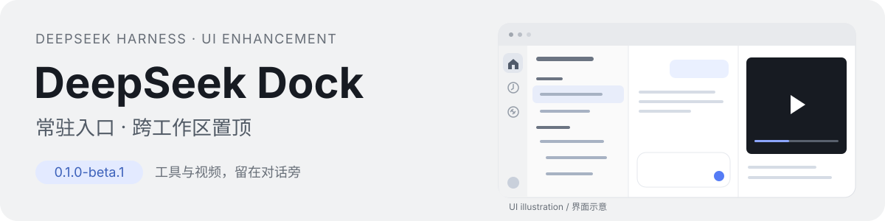
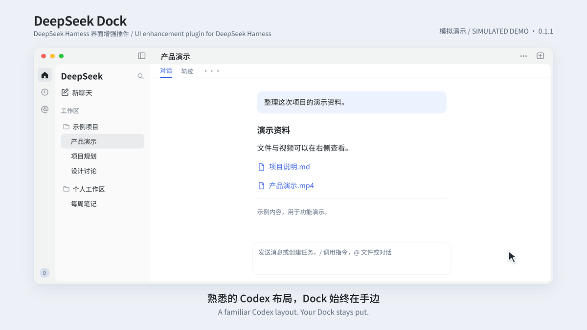
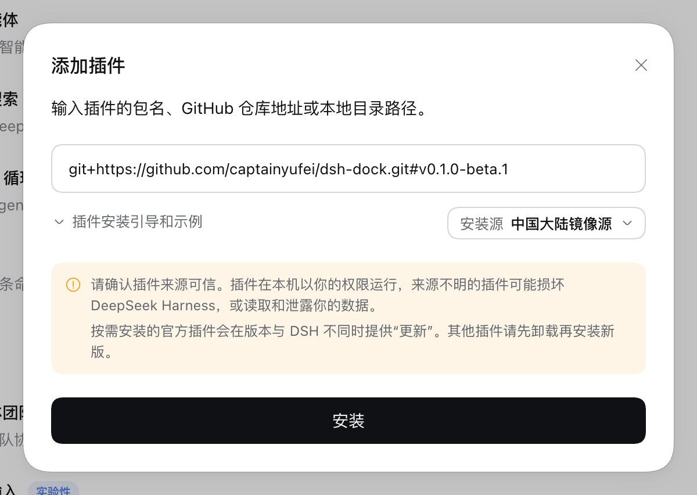

# DeepSeek Dock

[English](README.md) · **简体中文**

**为 DeepSeek Harness 增加左侧常驻、自定义 Dock，以及 Codex 风格 UI。**



跨工作区集中置顶重要会话；首页先写草稿，发送时才创建会话；视频直接在右侧文件面板预览，方便与旁边的对话核对。DeepSeek Dock 独立安装，无需修改宿主程序，保留 DeepSeek 品牌和原生工具。

`0.2.2` · 已验证宿主包括 **macOS / Harness 0.2.1-rc.5、0.2.2-rc.1 和 0.2.2-rc.2** · 第三方社区插件

[安装](#安装) · [功能](#功能) · [兼容与限制](#兼容与限制) · [旧版迁移](docs/MIGRATION.md) · [反馈问题](https://github.com/captainyufei/dsh-dock/issues)

## 看它如何工作

[](assets/readme/demo.mp4)

**[45 秒完整演示 · 带背景音乐](assets/readme/demo.mp4)** · [Watch in English](assets/readme/demo.en.mp4) · [静态预览](assets/readme/poster.png)

45 秒循环已按 0.2.0 更新，展示常驻应用 Dock、全部应用与固定排序、全局搜索、完成通知、返回/前进，以及已有文件和视频工具。点击可观看带音乐版本。画面按当前代码中的界面与操作制作，使用虚构示例数据；属于功能示意，不是实机录屏或性能测量。

## 功能

| 特点 | 日常使用有什么变化 |
|---|---|
| **应用 Dock 与全部应用** | 有页面的插件以单色图标显示，可固定、拖动排序或从全部应用搜索打开；未固定的最近应用单独显示。 |
| **全局搜索** | 集中查找会话标题、工作区和快捷操作；宿主启用正文索引时也可搜索聊天内容。 |
| **会话通知** | 铃铛显示完成摘要和待处理事项，首页与铃铛共用未读蓝点；已读完成记录仍可查看。 |
| **返回与前进** | 在本窗口访问过的全局页面和已有会话之间切换。 |
| **Codex 风格 UI** | 首页、会话、插件和自动化任务页共用窗口外框及可拖动顶栏。切页时沿用同一套导航和工具控制，保留 DeepSeek 品牌与原生会话层级。 |
| **跨工作区会话置顶** | 重要会话集中到顶部，查找时不用逐个展开工作区。同一会话只显示一次；取消置顶后回到原组，工作区归属不变。 |
| **发送时才创建会话的草稿首页** | 先输入、修改，再决定是否发送。真正发送消息时才创建会话，未发送的想法不会让侧栏多出空会话。 |
| **右侧文件面板预览视频** | 在右侧直接播放、拖动视频进度，同时核对旁边的对话要求。再次展开工具抽屉会恢复已有标签，继续查看原内容。 |

## 安装

需要 **macOS / Harness 0.2.1-rc.5 或从 rc.1 起的 0.2.2 系列**。若装有旧版 `@local/chatgpt-rail`，先停用它（[迁移说明](docs/MIGRATION.md)）。本插件尚未发布到 npm，请使用下面的仓库地址，无需自行编译。也可从 [GitHub Releases](https://github.com/captainyufei/dsh-dock/releases/latest) 下载安装包；ZIP 解压后选择包含 `package.json` 的完整文件夹。

这会安装 `main` 上的最新代码，不等同于最新稳定发布版。已安装的副本不会自动更新。

### 在 DeepSeek Harness 中安装

打开 **插件 → 添加插件**，将以下内容粘贴到 **包名或地址**，点击 **安装**：

```text
https://github.com/captainyufei/dsh-dock
```

出现 **已安装** 后，点击 **立即启用**。直接关闭窗口会让插件保持关闭。



在 **已安装插件** 中确认 **DeepSeek Dock** 已开启。收起会话列表，首页、自动化任务和插件入口应仍显示在左侧 Dock；右键 Dock 可自定义入口。

### 使用 `dsh` CLI 安装

安装到 **web profile**：

```sh
dsh plugin --profile web add https://github.com/captainyufei/dsh-dock
```

若 Web UI 尚未运行，执行 `dsh web` 启动，再打开 **插件** 确认 DeepSeek Dock 已启用。此命令针对 web profile；桌面版请使用上面的安装窗口。

### 更新或移除

先保存工作。若插件管理器提供 DeepSeek Dock 的 **更新** 按钮，直接更新，再按提示重新加载或重启。使用 TGZ、本地目录或仓库来源时，通过 **添加插件** 或官方 CLI 安装同名新版本。在详情中确认版本为 **0.2.2 或更新版本**。仅重新打开 Harness 不会下载新代码。

暂时不用时关闭开关；彻底移除时卸载后不再安装。两种操作都保留宿主管理的会话和工作区。

<details>
<summary>备用方式：从本地 ZIP 安装</summary>

1. [下载当前 main 分支](https://github.com/captainyufei/dsh-dock/archive/refs/heads/main.zip)，解压到准备长期保留的目录。这是下载时的 `main` 快照，不是固定发布版本。
2. 找到包含 `package.json` 和 `cordis.patch.yml` 的根目录，保留完整解压内容及全部子目录。
3. 在访达中选中该文件夹，按 **Option–Command–C** 复制绝对路径，粘贴到 **插件 → 添加插件**。例如，用户名为 `alex` 时，路径可能是：

   ```text
   /Users/alex/Plugins/dsh-dock
   ```

   请使用你实际保存的文件夹路径，不要原样填示例或选择 ZIP 文件。
4. 点击 **安装 → 立即启用**，再按上面的方法检查 Dock。安装后请保留本地目录。

</details>

<details>
<summary>安装遇到问题？展开排查</summary>

| 问题 | 下一步 |
|---|---|
| 找不到包 | 使用上面的完整仓库地址。本包尚未发布到 npm，不能只填包名或 `@latest` 安装。 |
| GitHub 下载失败 | 打开 **查看安装详情**，检查 GitHub 连接后重试。切换 npm 安装源不能修复 GitHub 连接；能单独下载时可用 ZIP 方式。 |
| 已安装但 Dock 没出现 | 在 **已安装插件** 中启用，并按提示重启。若启用失败，复制诊断信息。 |
| 宿主不匹配或目录无效 | Harness `0.2.2-rc.2` 需将 Dock 更新至 `0.2.2` 或更新版本。准入范围覆盖 `0.2.1-rc.5` 和从 `rc.1` 起、`0.2.3` 之前的 `0.2.2` 系列。旧版已安装副本仍带有原来的版本限制。本地安装时选中含 `package.json` 和 `cordis.patch.yml` 的根目录，确保解压内容完整。 |

[提交 issue](https://github.com/captainyufei/dsh-dock/issues) 时附 Harness/macOS 版本、填写的来源和安装错误；发布日志前删去私人路径或令牌。

</details>

## 日常操作

打开 Dock 底部“全部应用”可搜索、固定入口，按全部、已固定或最近使用筛选。右键图标可固定/移除、上移/下移；固定图标可直接拖动排序，松手落在图标间隙也生效，按 Esc 取消。首页固定第一；固定图标多时可滚动，未固定的最近应用显示在分隔线后。偏好保存在本机。

点击侧栏搜索按钮或使用宿主的搜索会话快捷键，打开全局搜索；可按方向键选择、Enter 打开、Esc 关闭。标题和工作区搜索始终可用，正文搜索依赖宿主索引；索引未启用时会提示并保留标题结果。

铃铛打开完成记录与待处理事项列表。新完成结果和待处理事项会点亮首页/铃铛蓝点；点击某条完成记录会打开原会话并标记该条已读，打开列表本身不会清除未读。首次安装以前的历史记录通常显示为已读；部分旧版日志可能无法读取。

左上角返回/前进记录本窗口访问过的全局页面和已有会话，刷新后重置。右键会话沿用宿主的置顶、重命名、分叉、归档/取消归档和复制 Session ID；也支持 `Shift+F10` 或菜单键。置顶行的归档入口复用宿主原生操作。

文件、终端、浏览器、工具标签和自动化任务由 Harness 提供。DeepSeek Dock 增强其外围界面并加入视频预览，不提供新的任务执行引擎。

### 草稿与输入

输入前可选择工作区、模式、模型和权限。切页或刷新后，草稿文字与选项可恢复；附件在刷新后需要重新选择。

`Enter` 发送，`Shift+Enter` 换行；中文输入法选词时的回车不会发送。`+` 选择本地文件，`@` 引用文件路径或已加载会话，麦克风复用宿主语音组件。附件只在发送时交给宿主。发送失败保留草稿，结果不明确时不会自动重发。

### 恢复工具与播放

原生文件标签可预览 MP4、M4V、MOV 和 WebM，提供暂停、跳转、音量和全屏控件；具体解码限制见下表。

有已有工具标签时，右上角按钮恢复原内容；当前会话没有标签时打开原生工具区。没有当前会话及可恢复内容时，才显示新建工具或选择会话入口。

收起抽屉、切换标签或关闭预览会暂停视频并释放临时媒体。重新打开同一标签、且文件版本未改变时，可恢复进度，**不会自动播放**。播放器保留键盘操作及焦点提示，窗口过渡遵循“减少动态效果”设置。

## 兼容与限制

| 项目 | 当前范围 |
|---|---|
| **宿主与平台** | macOS 验证基线包括 `0.2.1-rc.5`、`0.2.2-rc.1` 和 `0.2.2-rc.2`。`rc.2` 升级检查覆盖加载、侧栏结构、展开/折叠、1440/800/480 px 浏览器宽度、草稿保留、应用/全局搜索、拖动排序、菜单和通知。此前功能及主题验收沿用其原始宿主版本的记录。其他操作系统需要各自验收。 |
| **视频编码** | 扩展名识别不等于所有编码可解码；实际取决于系统/浏览器。已有 H.264/AAC MP4 实测，失败时可用系统应用打开。 |
| **桌面视频体积** | 桌面端先完整读取临时 Blob；缓存和在途媒体字节共享 **256 MiB** 预算，超限可外部打开。这不是进程内存峰值上限。 |
| **播放进度** | 恢复限于同一工具标签生命周期和同一文件版本，不保证应用重启后续播。 |
| **草稿与语音** | 附件不跨刷新保留。语音需宿主组件和本机识别资源；`/` 命令及 `@` 候选取决于宿主目录和权限。 |
| **语言** | README 提供中英文；部分新增界面文案仍为中文，尚未完成全界面国际化。 |

`0.2.2` 的准入范围为 `0.2.1-rc.5 || >=0.2.2-rc.1 <0.2.3-0`。后续被范围允许的候选版在发布后继续验证。维护工作流和安装来源要求见[兼容与更新交付说明](docs/COMPATIBILITY.md)。

置顶会话被隐藏后，原生分组首屏可见行数可能减少；继续展开可查看后续会话。插件使用宿主槽位、服务及部分 DOM 结构，宿主升级后需重新验证，不能保证未来版本自动兼容。

## 开发与贡献

在源码仓库根目录执行：

```sh
npm ci
npm test
npm run build:client
```

`npm test` 会先构建再运行测试；运行时共享宿主 React。修改源码后需要重新构建 `dist/client.js`，并通过宿主加载更新。测试结果应以当前提交的实际运行记录为准，模拟演示不代替功能验收。

[架构与状态归属](docs/ARCHITECTURE.md) · [统一窗口框架](docs/SURFACES.md) · [贡献指南](CONTRIBUTING.md) · [版本与发布规则](docs/RELEASING.md) · [更新记录](CHANGELOG.md)

## 授权与来源

DeepSeek Dock 是第三方独立插件，与 DeepSeek 或 OpenAI 没有隶属关系。“Codex 风格”仅描述布局设计。项目使用 [MIT License](LICENSE)，引用代码及第三方许可见 [THIRD_PARTY_NOTICES](THIRD_PARTY_NOTICES.md)。
