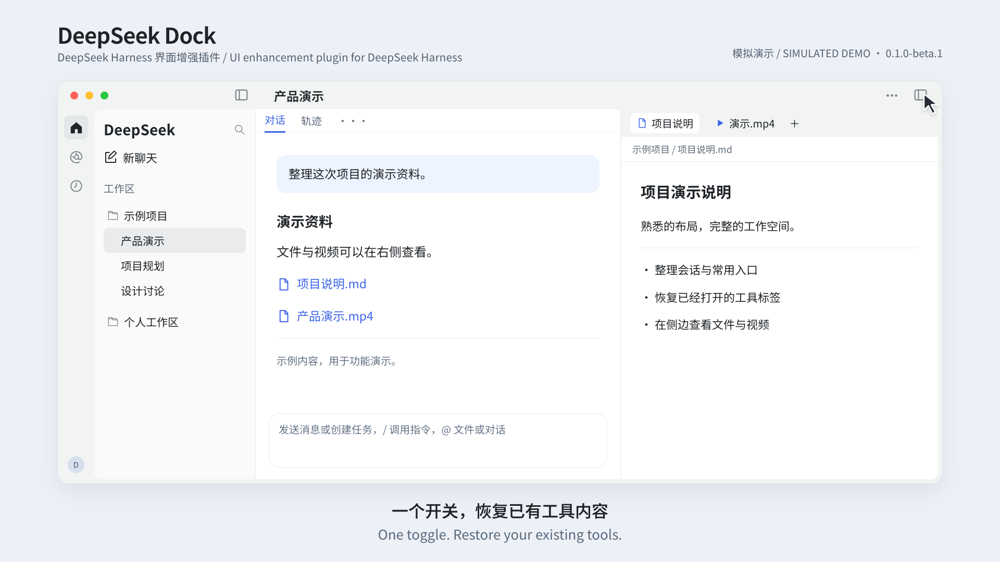

# DeepSeek Dock

[English](README.md) · **简体中文**

**收起会话列表，也能随时切换首页、任务和插件。**


DeepSeek Dock 是 DeepSeek Harness 的界面增强插件：常用入口留在左侧，重要会话集中置顶，文件和视频在对话旁打开。收起工具抽屉后，再次展开即可继续查看已有内容。独立安装，无需修改宿主程序。

`0.1.0-beta.1` · 目标环境：**macOS / Harness 0.2.1-rc.5** · 第三方社区插件

[安装](#安装) · [功能](#功能) · [兼容与限制](#兼容与限制) · [旧版迁移](docs/MIGRATION.md) · [反馈问题](https://github.com/captainyufei/dsh-dock/issues)

## 看它如何工作

[](assets/readme/demo.mp4)

**[播放中文版 · 45 秒 MP4](assets/readme/demo.mp4)** · [Watch in English](assets/readme/demo.en.mp4)

中英文版分别提供对应语言的画面文字与轻量背景音乐。视频使用示例数据模拟操作流程，不是实机录屏或性能测试；点击封面即可打开中文版。

## 它解决哪些日常问题

- **经常在首页、自动化任务和插件之间切换。** 收起会话列表后，Dock 仍显示这些入口。点一下就能切页，省去反复展开侧栏的操作。
- **重要会话分散在多个工作区。** 置顶后，它们集中到侧栏顶部，查找时不用逐个展开项目。原工作区不重复展示；取消置顶后回到原组，归属不变。
- **收起工具后，还要继续看刚才的文件或终端。** 再点右上角按钮会优先恢复已有工具标签，接着查看原内容，无需反复新建。
- **想边看生成的视频，边核对对话里的要求。** 视频直接在右侧文件标签中播放，对话留在旁边，方便逐项对照。
- **想先整理问题，再决定是否发送。** 首页先保存草稿，点击发送才创建会话；未发送的想法不会变成会话列表里的空条目。

首页、会话、插件和自动化任务页共用窗口外框。原生文件夹、会话层级、头像、权限检查和工具能力继续保留。

## 安装

需要 **macOS / Harness 0.2.1-rc.5**。若装有旧版 `@local/chatgpt-rail`，先停用它（[迁移说明](docs/MIGRATION.md)）。本测试版尚未发布到 npm，请使用下面的仓库地址，无需自行编译。

这会安装 `main` 上的最新代码，不等同于最新稳定发布版。已安装的副本不会自动更新。

### 在 DeepSeek Harness 中安装

打开 **插件 → 添加插件**，将以下内容粘贴到 **包名或地址**，点击 **安装**：

```text
https://github.com/captainyufei/dsh-dock
```

出现 **已安装** 后，点击 **立即启用**。直接关闭窗口会让插件保持关闭。


在 **已安装插件** 中确认 **DeepSeek Dock** 已开启。收起会话列表，首页、自动化任务和插件入口应仍显示在左侧 Dock；右键 Dock 可自定义入口。

### 使用 `dsh` CLI 安装

安装到 **web profile**：

```sh
dsh plugin --profile web add https://github.com/captainyufei/dsh-dock
```

若 Web UI 尚未运行，执行 `dsh web` 启动，再打开 **插件** 确认 DeepSeek Dock 已启用。此命令针对 web profile；桌面版请使用上面的安装窗口。

### 更新或移除

要取得当前 `main` 代码，先保存工作，打开 **插件 → DeepSeek Dock → 卸载** 并确认。再使用上面同一仓库地址或 CLI 命令重新安装并启用，按提示重新加载或重启，在插件详情中核对来源和版本。必须重新安装；仅重新打开 Harness 不会下载新代码。

暂时不用时关闭开关；彻底移除时卸载后不再安装。两种操作都保留宿主管理的会话和工作区。

<details>
<summary>可复现的备用方式：固定发布版或本地 ZIP</summary>

若希望始终安装同一公开测试版，而不跟随 `main`，在安装窗口使用以下来源：

```text
git+https://github.com/captainyufei/dsh-dock.git#v0.1.0-beta.1
```

此标签固定为 `0.1.0-beta.1`，重新安装它也不会取得更新代码。需要本地安装时：

1. [下载本次版本](https://github.com/captainyufei/dsh-dock/archive/refs/tags/v0.1.0-beta.1.zip)，解压到准备长期保留的目录。
2. 找到包含 `package.json` 和 `cordis.patch.yml` 的根目录，保留完整解压内容及全部子目录。
3. 在访达中选中该文件夹，按 **Option–Command–C** 复制绝对路径，粘贴到 **插件 → 添加插件**。例如，用户名为 `alex` 时，路径可能是：

   ```text
   /Users/alex/Plugins/dsh-dock
   ```

   请使用你实际保存的文件夹路径，不要原样填示例或选择 ZIP 文件。
4. 点击 **安装 → 立即启用**，再按上面的方法检查 Dock。安装后请保留本地目录。

</details>

<details>
<summary>安装遇到问题？展开排查</summary>

| 问题 | 下一步 |
|---|---|
| 找不到包 | 使用上面的完整仓库地址。本包尚未发布到 npm，不能只填包名或 `@latest` 安装。 |
| GitHub 下载失败 | 打开 **查看安装详情**，检查 GitHub 连接后重试。切换 npm 安装源不能修复 GitHub 连接；能单独下载时可用 ZIP 方式。 |
| 已安装但 Dock 没出现 | 在 **已安装插件** 中启用，并按提示重启。若启用失败，复制诊断信息。 |
| 宿主不匹配或目录无效 | 使用 Harness `0.2.1-rc.5`。本地安装时选中含 `package.json` 和 `cordis.patch.yml` 的根目录，确保解压内容完整。 |

[提交 issue](https://github.com/captainyufei/dsh-dock/issues) 时附 Harness/macOS 版本、填写的来源和安装错误；发布日志前删去私人路径或令牌。

</details>

## 功能

| 能力 | 实际行为 |
|---|---|
| **常驻 Dock** | 收起会话列表后，左侧导航和真实头像仍可使用。默认入口为首页、自动化任务和插件。 |
| **自定义入口** | 右键添加或移除已注册入口，直接拖动排序。首页固定第一；最多直接显示 6 项，其余进入“更多”。偏好保存在本机。 |
| **全局置顶** | 不同工作区的置顶会话集中显示，原组不再重复展示；取消后回到原组。 |
| **会话右键菜单** | 复用宿主的置顶、重命名、分叉、归档/取消归档和复制 Session ID。支持 `Shift+F10` 或菜单键。 |
| **独立首页草稿** | 先选工作区、模式、模型和权限，再输入内容。发送时才创建会话；切页或刷新可恢复文字与选项。 |
| **统一窗口与工具区** | 顶部可拖窗，各主页面共用外框；同一右上角按钮展开/收起，优先恢复已有标签，保留原生调整宽度和分栏。 |
| **侧边视频播放** | 在原生文件标签内播放 MP4、M4V、MOV、WebM，提供暂停、跳转、音量和全屏。隐藏时暂停，同一标签及文件版本下可恢复位置。 |

文件、终端、浏览器、工具标签和自动化任务由 Harness 提供。本插件负责导航、会话展示、草稿首页、统一交互及新增视频预览，不提供新的任务执行引擎。

### 草稿与输入

`Enter` 发送，`Shift+Enter` 换行；中文输入法选词时的回车不会发送。`+` 选择本地文件，`@` 引用文件路径或已加载会话，麦克风复用宿主语音组件。附件只在发送时交给宿主，刷新后需重新选择。发送失败保留草稿，结果不明确时不会自动重发。

### 恢复工具与播放

有已有工具标签时，右上角按钮恢复原内容；当前会话没有标签时打开原生工具区。没有当前会话及可恢复内容时，才显示新建工具或选择会话入口。

收起抽屉、切换标签或关闭预览会暂停视频并释放临时媒体。重新打开同一标签、且文件版本未改变时，可恢复进度，**不会自动播放**。播放器保留键盘操作及焦点提示，窗口过渡遵循“减少动态效果”设置。

## 兼容与限制

| 项目 | 当前范围 |
|---|---|
| **宿主与平台** | 功能基线在 macOS / Harness `0.2.1-rc.5` 实机验证。此包限制到该宿主版本；其他系统、深色模式和极窄窗口未全面实机验证。 |
| **视频编码** | 扩展名识别不等于所有编码可解码；实际取决于系统/浏览器。已有 H.264/AAC MP4 实测，失败时可用系统应用打开。 |
| **桌面视频体积** | 桌面端先完整读取临时 Blob；缓存和在途媒体字节共享 **256 MiB** 预算，超限可外部打开。这不是进程内存峰值上限。 |
| **播放进度** | 恢复限于同一工具标签生命周期和同一文件版本，不保证应用重启后续播。 |
| **草稿与语音** | 附件不跨刷新保留。语音需宿主组件和本机识别资源；`/` 命令及 `@` 候选取决于宿主目录和权限。 |
| **语言** | README 提供中英文；部分新增界面文案仍为中文，尚未完成全界面国际化。 |

置顶会话被隐藏后，原生分组首屏可见行数可能减少；继续展开可查看后续会话。插件使用宿主槽位、服务及部分 DOM 结构，宿主升级后需重新验证，不能保证未来版本自动兼容。

## 开发与贡献

在源码仓库根目录执行：

```sh
npm ci
npm test
npm run build:client
```

`npm test` 会先构建再运行测试；运行时共享宿主 React。修改源码后需要重新构建 `dist/client.js`，并通过宿主加载更新。测试结果应以当前提交的实际运行记录为准，模拟演示不代替功能验收。

[架构与状态归属](docs/ARCHITECTURE.md) · [贡献指南](CONTRIBUTING.md) · [版本与发布规则](docs/RELEASING.md) · [更新记录](CHANGELOG.md)

## 授权与来源

DeepSeek Dock 是第三方独立插件，与 DeepSeek 官方没有隶属关系。项目使用 [MIT License](LICENSE)，引用代码及第三方许可见 [THIRD_PARTY_NOTICES](THIRD_PARTY_NOTICES.md)。
